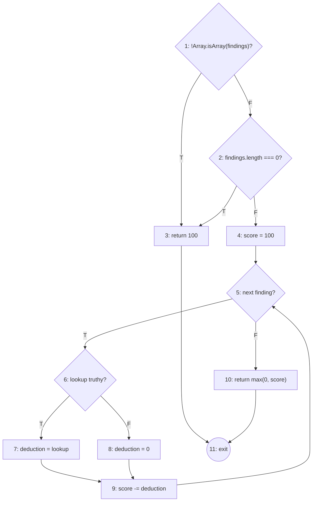
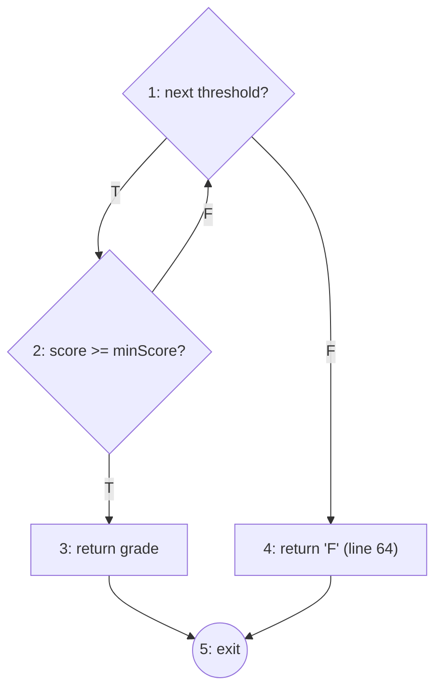
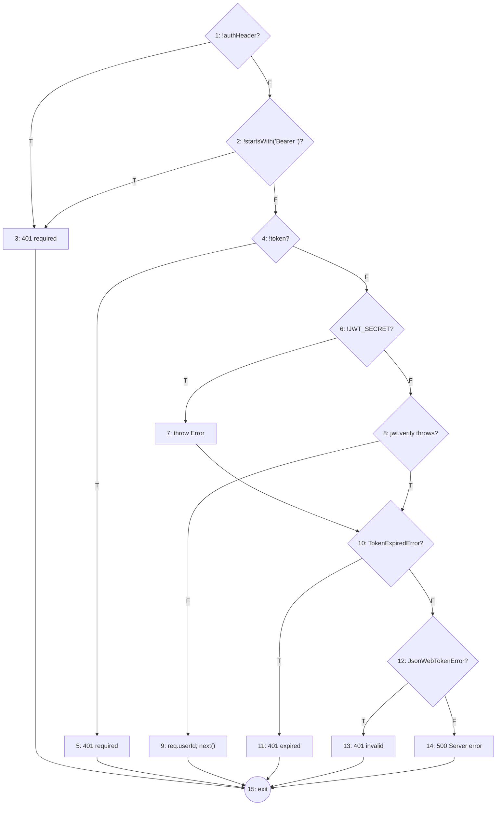
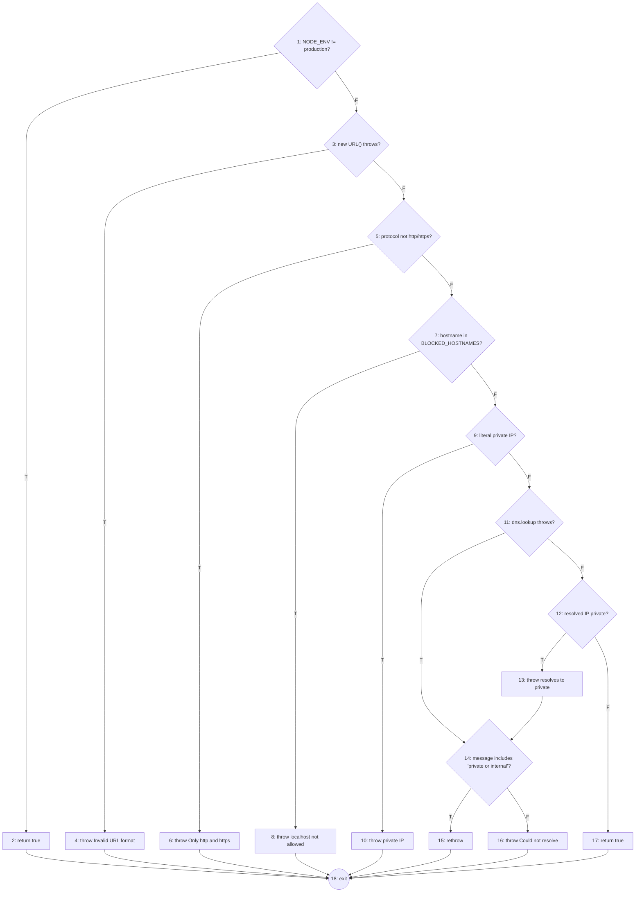

# White-Box Analysis: Control Flow, Cyclomatic Complexity and Coverage

| Item | Value |
|---|---|
| Document ID | QA-WB-04 |
| Units analysed | `calculateScore`, `scoreToGrade` (utils/scoring.js), `authMiddleware` (middleware/authMiddleware.js), `blockPrivateTargets` (validators/scanValidators.js, the SSRF guard) |
| Basis-path tests | [`tests/basis-paths.test.js`](tests/basis-paths.test.js): 25 tests |
| Coverage evidence | `qa/evidence/coverage/baseline.txt` (before), `qa/evidence/coverage/after-whitebox.txt` (after) |
| Tools | Node.js built-in test runner + V8 coverage (`--experimental-test-coverage`), ESLint `complexity` rule (tool-computed V(G)) |

White-box testing designs tests from the internal structure of the code. Black-box testing asks whether the software meets its specification. White-box testing asks a different question: has every path through the code actually been exercised, and is any of it dead, unreachable or simply wrong?

## 1. Key concepts

| Term | Meaning |
|---|---|
| **Control-flow graph (CFG)** | Nodes are blocks of sequential statements or decisions. Edges are possible transfers of control. |
| **Cyclomatic complexity V(G)** | The number of **linearly independent paths** through the CFG, which is the minimum number of tests for *basis path coverage*. Three equivalent formulas: **V(G) = E − N + 2** (edges − nodes + 2, single component), **V(G) = P + 1** (P = binary decision points, with each `&&`/`\|\|` operand counted), and **V(G) = number of enclosed regions + 1**. |
| **Statement coverage** | % of executable statements run at least once |
| **Branch (decision) coverage** | % of decision *outcomes* (true and false of every `if`, loop, `\|\|`, `catch`) taken at least once. Branch coverage ⇒ statement coverage, but not the reverse. |
| **Basis path testing** | One test per independent path (V(G) tests). This guarantees 100% branch coverage of the unit when every path is feasible. |
| **Infeasible path** | A path that exists in the graph but can never be executed, because no input satisfies all its conditions together |

Risk bands for V(G) (McCabe / SEI): **1–10** simple, low risk · **11–20** moderate · **21–50** complex, high risk · **> 50** untestable.

## 2. Tool-computed complexity (ESLint `complexity` rule, all server functions with V(G) ≥ 3)

| Function | File | V(G) | Risk |
|---|---|---|---|
| **`runScan`** | controllers/scanController.js | **31** | **High**: 31 independent paths, at 23.9% line coverage |
| `errorHandler` | middleware/errorHandler.js | 11 | Moderate |
| `blockPrivateTargets` | validators/scanValidators.js | 9 | Low |
| `authMiddleware` | middleware/authMiddleware.js | 8 | Low |
| `calculateScore` | utils/scoring.js | 5 | Low |
| `register`, `login` | controllers/authController.js | 4 | Low |
| `groupFindingsByCategory`, `summarizeSeverity` | controllers/scanController.js | 4 | Low |
| `GET /history/:id` handler | routes/scanRoutes.js | 4 | Low |
| `scoreToGrade`, `getMe`, `findOwnedScan`, `updateScanNote`, `deleteScan` | various | 3 | Low |

The hand-computed values below match the tool for all four units analysed.

---

## 3. `calculateScore(findings)`: V(G) = 5

```js
35  if (!Array.isArray(findings) || findings.length === 0) {   // D1, D2
36    return STARTING_SCORE;
37  }
39  let score = STARTING_SCORE;
41  for (const finding of findings) {                            // D3
45    const deduction = SEVERITY_DEDUCTIONS[finding.severity] || 0;   // D4
46    score -= deduction;
47  }
49  return Math.max(MINIMUM_SCORE, score);
```



| Formula | Calculation | V(G) |
|---|---|---|
| E − N + 2 | 14 edges − 11 nodes + 2 | **5** |
| P + 1 | 4 decisions (D1 isArray, D2 length, D3 loop, D4 `\|\| 0`) + 1 | **5** |
| ESLint | | **5** |

| Path | Route | Test input | Expected | Test id |
|---|---|---|---|---|
| P1 | 1 → 3 → 11 | `null` | 100 | CS-P1 |
| P2 | 1 → 2 → 3 → 11 | `[]` | 100 | CS-P2 |
| P3 | 1 → 2 → 4 → 5 → 6(T) → 7 → 9 → 5 → 10 | `[{HIGH}]` | 85 | CS-P3 |
| P4 | … 5 → 6(F) → 8 → 9 → 5 → 10 | `[{UNKNOWN}]` | 100 | CS-P4 |
| P5 | loop several times, floor applies | `5 × CRITICAL` | 0 | CS-P5 |

This function is a good illustration of the difference between statement and branch coverage. The single test `[{HIGH}]` runs line 45 completely, so statement coverage counts that line as covered. But it never takes the `|| 0` outcome, and only branch coverage reveals that path P4 is untested. The same goes for D1 and D2: a test with `[]` runs line 35, but only a `null` input makes the first condition true.

## 4. `scoreToGrade(score)`: V(G) = 3



| Formula | Calculation | V(G) |
|---|---|---|
| E − N + 2 | 6 − 5 + 2 | **3** |
| P + 1 | 2 decisions + 1 | **3** |

| Path | Route | Input | Expected | Test id |
|---|---|---|---|---|
| P1 | 1 → 2(T) → 3 | 95 | A | SG-P1 |
| P2 | 1 → 2(F) → 1 → … → 2(T) → 3 | 50 | D | SG-P2 |
| P3 | 1 → 2(F) ×5 → 1(F) → 4 | `NaN` | F | SG-P3 |

Line 64 carries the comment "unreachable given the thresholds above". Our analysis showed that it is in fact reachable: `NaN >= 0` is false, and so is the comparison for any negative number. The baseline coverage run confirmed that line 64 was the only uncovered line in scoring.js. The comment is wrong, although the behaviour (returning F) is safe.

## 5. `authMiddleware`: V(G) = 8



| Formula | Calculation | V(G) |
|---|---|---|
| E − N + 2 | 21 − 15 + 2 | **8** |
| P + 1 | 7 decisions (D1, D2, D4, D6, D8, D10, D12) + 1 | **8** |
| ESLint | | **8** |

| Path | Route | Input | Expected | Test id | Existing test? |
|---|---|---|---|---|---|
| P1 | 1(T) → 3 | no header | 401 required | AM-P1 | yes |
| P2 | 1(F) → 2(T) → 3 | `Basic …` | 401 required | AM-P2 | **no** |
| P3 | … 4(T) → 5 | `Bearer ` (empty) | 401 required | AM-P3 | **no** |
| P4 | … 6(F) → 8(F) → 9 | valid token | `next()` | AM-P4 | yes |
| P5 | … 6(T) → 7 → 10(F) → 12(F) → 14 | `JWT_SECRET` unset | 500 | AM-P5 | **no** |
| P6 | … 8(T) → 10(T) → 11 | expired token | 401 expired | AM-P6 | yes (status only) |
| P7 | … 8(T) → 10(F) → 12(T) → 13 | wrong signature | 401 invalid | AM-P7 | yes |
| P8 | … 8(T) → 10(F) → 12(F) → 14 | **token with `nbf` in the future** | **401** | AM-P8 | **no → FAILS: 500** |

This analysis found DEF-007. Working through the paths made us ask which errors `jwt.verify` can throw, and whether each one reaches the right branch. The jsonwebtoken library throws three error types: `TokenExpiredError`, `JsonWebTokenError` and `NotBeforeError`. The third has `name === "NotBeforeError"`, so it matches neither check in the code and falls through to a 500 Server error. A black-box tester would be unlikely to think of a token that is "not valid yet"; the idea came directly from reading the decision at node 12.

## 6. `blockPrivateTargets(url)` (SSRF guard): V(G) = 9



| Formula | Calculation | V(G) |
|---|---|---|
| E − N + 2 | 25 − 18 + 2 | **9** |
| P + 1 | 8 decisions + 1 | **9** |
| ESLint | | **9** |

The guard is not exported, so we tested it through the real validator chain (`scanValidationRules`). We replaced DNS with a test double, a stub for `dns.promises.lookup`, which made the rebinding and DNS-failure paths predictable and kept the tests off the network.

| Path | Route | Input | Expected | Test id | Feasible? |
|---|---|---|---|---|---|
| P1 | 1(T) → 2 | dev, `http://10.0.0.5` | allowed | BP-P1 | ✔ (was uncovered) |
| P2 | 1(F) → 3(T) → 4 | URL that passes `isURL` but fails `new URL` | "Invalid URL format" | – | **✘ Infeasible.** `isURL` + `.bail()` guarantee the URL parses, so lines 46–47 can never run. |
| P3 | … 5(T) → 6 | `ftp://example.com` | "Only http and https" | BP-P3 | ✔ (was uncovered) |
| P4 | … 7(T) → 8 | `http://0.0.0.0` | "localhost … not allowed" | BP-P4 | ✔ (was uncovered) |
| P5 | … 9(T) → 10 | `http://10.0.0.5` | "private … IP" | BP-P5 | ✔ |
| P6 | … 11(T) → 14(F) → 16 | stub throws `ENOTFOUND` | "Could not resolve" | BP-P8 | ✔ (was uncovered) |
| P7 | … 11(F) → 12(T) → 13 → 14(T) → 15 | stub returns `10.1.2.3` | "resolves to a private…" | BP-P6 | ✔ (was uncovered) |
| P8 | … 11(F) → 12(F) → 17 | stub returns `93.184.216.34` | allowed | BP-P7 | ✔ (was uncovered) |
| P9 | … 11(T) → 14(T) → 15 | a DNS error whose message contains "private or internal" | rethrow | – | **✘ Infeasible** (resolver errors never contain that text) |

The SSRF guard turned out to contain checks that can never fire, which we logged as OBS-05. The first problem was a test that passes for the wrong reason. The existing test "production blocks `http://localhost:3000`" passes, yet the baseline coverage showed that lines 58–59, the localhost branch, never ran. `isURL()` rejects `localhost` (it has no top-level domain) before the guard is even reached, so the `"localhost"` entry in `BLOCKED_HOSTNAMES` is dead code; only `0.0.0.0` reaches it, as test BP-P4b documents.

The second problem was that the IPv6 patterns could never match. `new URL("http://[::1]/").hostname` returns `"[::1]"` with the square brackets, so `/^::1$/`, `/^fc00:/` and `/^fe80:/` never match anything. IPv6 literals were only being rejected because DNS cannot resolve `"[::1]"` (test BP-X1). They were still blocked, but by accident rather than by design, so we flagged this for a closer look in Phase 9 under OWASP A10 (SSRF).

## 7. Coverage: before and after

Command:
```powershell
node --test --experimental-test-coverage --test-coverage-include="server/**" --test-coverage-exclude="server/tests/**" --test-coverage-exclude="server/node_modules/**" "server/tests/*.test.js" "qa/04-white-box/tests/*.test.js"
```

| File | Line % before → after | Branch % before → after | Uncovered after |
|---|---|---|---|
| utils/scoring.js | 98.75 → **100** | 91.67 → **100** | – |
| middleware/authMiddleware.js | 79.49 → **100** | 75.00 → **100** | – |
| validators/scanValidators.js | 72.09 → **91.47** | 40.00 → **95.00** | 46–47 (infeasible P2), 114–122 (`handleValidationErrors`, covered at API level) |
| *All loaded files* | 56.19 → 58.05 | 85.71 → 97.83 | |

In total we had 57 tests (the 32 existing ones plus our 25 basis-path tests), and 56 of them passed. The one failure was AM-P8, which we left failing on purpose to document DEF-007 until it was fixed in Phase 5.

### How to read these numbers

Coverage figures are easy to misread, and this phase gave us four examples. First, files that no test loads are invisible. `authController.js`, `authValidators.js`, `errorHandler.js`, `rateLimiter.js` and `models/user.js` are not required by any unit test, so V8 does not list them at all. Their real unit coverage was 0%, but the headline "all files 58%" hid that. We fixed this in Phase 5 with Jest's `collectCoverageFrom`.

Second, "100% branch coverage" means little for a file that hardly ran. `sslCheck.js` showed 17% line coverage but 100% branch coverage, because V8 only counts branches inside functions that actually executed. Line, branch and function percentages have to be read together.

Third, full coverage does not mean the code is correct. Coverage shows that code ran, not that its result was checked. The localhost SSRF test ran code and passed, while the branch it was named after never executed at all.

Fourth, 100% is sometimes impossible. Infeasible paths (P2 and P9 above) and dead UI code (OBS-01, the ownership message in `Dashboard.jsx`) keep coverage below 100%. The right response is to remove or simplify the dead code, not to game the number.

## 8. Recommendations

| # | Recommendation | Why |
|---|---|---|
| 1 | Split `runScan` (V(G) = 31) into `fetchTarget()`, `runChecks()` (a table of check functions run in a loop with one shared try/catch) and `mapFetchError()` (a lookup table of error code → status/message) | Brings each function under 10, makes it unit-testable without network access, and removes ~6 near-identical try/catch blocks |
| 2 | Handle `NotBeforeError` (or check `error instanceof jwt.JsonWebTokenError`, its base class) | Fixes DEF-007 |
| 3 | Strip brackets from IPv6 hostnames before the regex check, and remove the dead `"localhost"` entry or check before `isURL` | Makes the SSRF guard work by design, not by accident (OBS-05) |
| 4 | Remove the unreachable `catch` around `new URL()` in the guard, and the dead branch in `Dashboard.handleSubmit` | Dead code lowers maintainability and can never reach 100% coverage |
| 5 | Fix the "unreachable" comment on scoring.js line 64 | The comment is false (NaN or negative input reaches it) |
