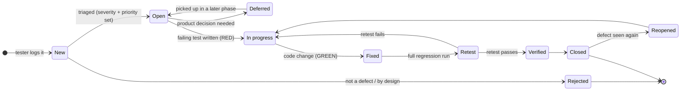

# Defect Lifecycle

| Item | Value |
|---|---|
| Document ID | QA-DLC-10 |
| Scope | 10 defects and 8 observations from [defect-log.md](defect-log.md) |
| Source of the paths | the defect log, phase notes, TDD evidence (`qa/evidence/tdd/`) and commit history |

## 1. The lifecycle model

The project uses the standard model below. The simplified path from the brief, **New → Open → Fixed → Retest → Closed**, is the main line; *In progress* and *Verified* are the extra states the team actually recorded, and the side states are used for observations and failed retests.

| State | Meaning in this project | Entry evidence |
|---|---|---|
| New | Logged in `defect-log.md` with steps, expected, actual | failing test case ID (TC-, EP-, BVA-, AM-…) |
| Open | Triaged: severity and priority set, assigned to a fix phase | row in the defect log table |
| In progress | **TDD RED**: a regression test that reproduces the defect exists and fails for the right reason | `qa/evidence/tdd/01-red.txt` and similar |
| Fixed | **TDD GREEN**: the smallest code change that makes the test pass | `0x-green-*.txt` |
| Retest | The original failing case is re-run, plus the full regression suite | Jest, node:test, API runner, black-box runner, BDD, Postman, Selenium |
| Verified | Retest passed; nothing else broke | `08-green-all.txt`, ZAP rerun, Selenium run |
| Closed | Status set in the log, regression test kept in the suite permanently | defect log status column |
| Deferred | Not fixed in this cycle; recorded as a recommendation | OBS-07, OBS-08 |
| Rejected | Not a defect (works as designed) | part of OBS-03 (score gaps) |

## 2. Each defect's real path

### 2.1 Phase-by-phase timeline

● = found (New/Open), ○ = still open, ◐ = re-confirmed while open, ✔ = fixed, retested and closed, ⏸ = deferred

| ID | Sev. | P2 STLC | P3 Black-box | P4 White-box | P5 Unit/TDD | P6 BDD | P7 Postman/Sel. | P8 CI | P9 Perf/Sec |
|---|---|---|---|---|---|---|---|---|---|
| DEF-001 | High | ● | ○ | ○ | ✔ (2 retests) | | | | |
| DEF-002 | Med | ● | ○ | ○ | ✔ | | | | |
| DEF-003 | Low | ● | ○ | ○ | ✔ | | | | |
| DEF-004 | Low | ● | ◐ | ○ | ✔ | | | | |
| DEF-005 | Med | | ● | ○ | ✔ | | | | |
| DEF-006 | Low | | ● | ○ | ✔ | | | | |
| DEF-007 | Low | | | ● | ✔ | | | | |
| DEF-008 | Med | | | | ●✔ | | | | |
| DEF-009 | High | | | | | | | | ●✔ |
| DEF-010 | Med | | | | | | | | ●✔ |
| OBS-01 | obs | ● | ○ | ○ | ✔ | | | | |
| OBS-02 | obs | | ● | ○ | ✔ | | | | |
| OBS-03 | obs | | ● | ○ | ○ | ○ | ○ | ○ | ✔ (part rejected) |
| OBS-04 | obs | | ● | ○ | ⏸ | ⏸ | ⏸ | ⏸ | ✔ |
| OBS-05 | obs | | | ● | ✔ | | | | |
| OBS-06 | obs | | | | | | ●✔ | | |
| OBS-07 | obs | | | | | | | | ● ⏸ |
| OBS-08 | obs | | | | | | | | ● ⏸ |

Phases 2 to 4 were planned as **test design and execution** phases, and Phase 5 as the **fix phase** (TDD). So defects found in Phases 2–4 stayed Open until Phase 5 by plan, not by delay. From Phase 5 onwards, defects were fixed in the phase that found them.

### 2.2 Path of each defect, state by state

| ID | Real path | Notes |
|---|---|---|
| DEF-001 | New (P2, TC-REG-10) → Open (High/P1; Phase 2 exit criterion "no open High defect" **not met**) → In progress (P5 RED) → Fixed → **Retest FAIL** → In progress → Fixed → Retest PASS → Verified → Closed (P5) | The first retest stayed red: removing `normalizeEmail()` exposed **DEF-008** (`02-still-red-DEF-001-reveals-DEF-008.txt`). It went back to In progress, not Reopened, because it had never been closed. |
| DEF-002 | New (P2, TC-API-05) → Open → In progress (P5) → Fixed → Retest → Verified → Closed (P5) | `05-green-DEF-002-003.txt` |
| DEF-003 | New (P2, TC-API-04) → Open → In progress (P5) → Fixed → Retest → Verified → Closed (P5) | same evidence as DEF-002 |
| DEF-004 | New (P2, run 1 cascade) → Open (workaround: scan `127.0.0.1`) → re-confirmed (P3, EP-URL-04) → In progress (P5) → Fixed → Retest → Verified → Closed (P5) | The only defect seen again while still open. The workaround let testing continue. |
| DEF-005 | New (P3, EP-PW-06) → Open → In progress (P5) → Fixed → Retest → Verified → Closed (P5) | `07-green-DEF-005.txt` |
| DEF-006 | New (P3, EP-SC-06) → Open → In progress (P5) → Fixed → Retest → Verified → Closed (P5) | `07-green-DEF-006.txt` |
| DEF-007 | New (P4, AM-P8) → Open (test **left failing on purpose**, 56/57) → In progress (P5) → Fixed → Retest → Verified → Closed (P5) | The failing basis-path test was the "In progress" marker before the fix phase. |
| DEF-008 | New (P5, while retesting DEF-001) → Open → In progress → Fixed → Retest → Verified → Closed (P5) | Found and closed in the same phase. `03-red-DEF-008.txt` → `04-green-DEF-001-008.txt` |
| DEF-009 | New (P9, code review + security tests) → Open (High/P1) → In progress (5 tests RED) → Fixed (`ssrfGuard.js`) → Retest (35/35 security, 259/259 Jest, BDD, Postman, Selenium) → Verified → Closed (P9) | Found and closed in the same phase. |
| DEF-010 | New (P9, ZAP passive scan) → Open → In progress (drift test RED) → Fixed → Retest (ZAP rerun 0 Medium / 0 Low; 11 Selenium tests against the CSP build) → Verified → Closed (P9) | Retest used the same tool that found it (ZAP). |
| OBS-01 | New (P2, TC-UI-05) → Open → In progress (P5) → Fixed → Retest (manual, screenshot) → Closed (P5) | |
| OBS-02 | New (P3) → Open → Fixed → Retest → Closed (P5) | |
| OBS-03 | New (P3) → Open → split in P9: grade `E` → Fixed → Retest → Closed; score gaps → **Rejected** (by design) | One observation, two outcomes. |
| OBS-04 | New (P3) → Open → **Deferred** to P9 (OWASP A07) → In progress → Fixed → Retest → Closed (P9) | Breached-password check remains a recommendation. |
| OBS-05 | New (P4) → Open → In progress (P5) → Fixed → Retest → Closed (P5) | |
| OBS-06 | New (P7) → In progress (TC-UI-11 RED) → Fixed → Retest (3 runs, 33/33) → Closed (P7) | |
| OBS-07 | New (P9) → **Deferred** | Rate limit is a product decision. |
| OBS-08 | New (P9) → **Deferred** | Capacity note, not a defect. |

### 2.3 DEF-001's path drawn out

DEF-001 is the only defect whose path loops, so it is shown separately.

```mermaid
stateDiagram-v2
    direction LR
    [*] --> New: P2 TC-REG-10 fails
    New --> Open: High / P1
    Open --> InProgress1: P5 RED (3 tests)
    InProgress1 --> Fixed1: normalizeEmail() → toLowerCase()
    Fixed1 --> Retest1
    Retest1 --> InProgress2: still RED, register now 400 (DEF-008 found)
    InProgress2 --> Fixed2: DEF-008 fixed (model regex)
    Fixed2 --> Retest2
    Retest2 --> Verified: GREEN, full regression
    Verified --> Closed
    Closed --> [*]

    InProgress1: In progress
    InProgress2: In progress (again)
    Fixed1: Fixed (attempt 1)
    Fixed2: Fixed (attempt 2)
    Retest1: Retest 1
    Retest2: Retest 2
```

## 3. Summary of states reached

| Final state | Defects | Observations |
|---|---|---|
| Closed | 10 / 10 | 6 / 8 (OBS-03 partly Rejected) |
| Deferred | 0 | 2 (OBS-07, OBS-08) |
| Reopened after closing | **0** | 0 |
| Retest failed at least once | 1 (DEF-001) | 0 |

No defect was reopened after closing, because each fix left a permanent regression test that CI runs on every `qa/` branch.
